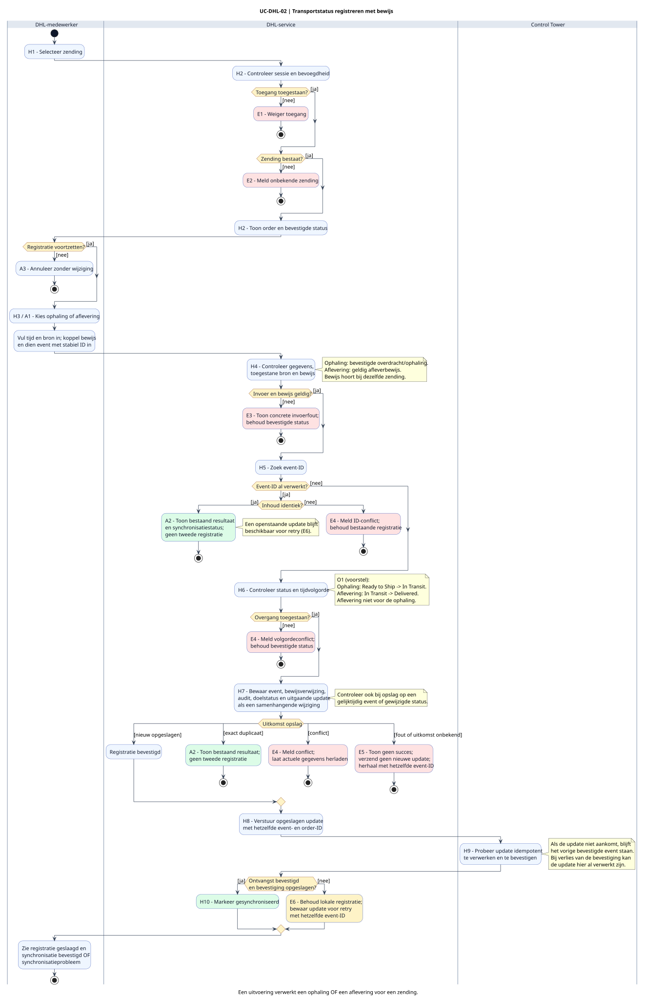

# Activitydiagram UC-DHL-02

Dit UML-activitydiagram beschrijft hoe een DHL-medewerker **één bevestigde ophaling of aflevering** registreert. Het ondersteunt must-have [FR-DHL-02, issue #30](https://github.com/Immanuel-Cairo/gifts4u-control-tower/issues/30), binnen [DHL-epic #14](https://github.com/Immanuel-Cairo/gifts4u-control-tower/issues/14).

Producttaak: **DHL-ACT-01**, [issue #81](https://github.com/Immanuel-Cairo/gifts4u-control-tower/issues/81). Status: concept voor inhoudelijke peer review, geen gerealiseerde software.

## Diagram



[Open de schaalbare afbeelding](activity-uc-dhl-02.svg) om in te zoomen. De bewerkbare bron staat in [activity-uc-dhl-02.puml](activity-uc-dhl-02.puml).

## Leeswijzer

- De zwarte startmarkering en eindmarkeringen begrenzen één registratie. Ophaling en aflevering zijn afzonderlijke uitvoeringen; het diagram wacht niet op een fysieke bezorging.
- De drie swimlanes geven aan wie een activiteit uitvoert: de DHL-medewerker, de DHL-service of de Control Tower.
- Beslissingen hebben expliciete voorwaarden tussen vierkante haken. Afwijzingen eindigen de huidige poging; na correctie begint een nieuwe poging.
- Groen betekent een geaccepteerd of eerder verwerkt resultaat; rood een afwijzing of opslagprobleem; geel een lokaal geaccepteerde registratie met een synchronisatieprobleem. Tekst vermeldt het resultaat ook zonder kleur.
- `H`, `A` en `E` verwijzen naar respectievelijk het hoofdscenario, alternatieven en uitzonderingen in de specificatie. `O1` is een voorgestelde volgorderegel.

## Aansluiting op de use case

De specificatie wordt afzonderlijk gereviewd in [issue #80](https://github.com/Immanuel-Cairo/gifts4u-control-tower/issues/80). Dit diagram is gebaseerd op de [specificatieversie in commit 6802e75](https://github.com/Immanuel-Cairo/gifts4u-control-tower/blob/6802e7560d417efcb6026548bad043bf694e36ce/products/dhl/use-case-uc-dhl-02.md). Na merge staat zij in `products/dhl/use-case-uc-dhl-02.md` op de hoofdbranch. Verwerk latere inhoudelijke wijzigingen ook in het diagram.

| Scenario / criterium | Waar terug te zien |
| --- | --- |
| H1-H3; A3 | Zending kiezen, toegang/bestaan controleren, voortzetten of annuleren, gebeurtenis indienen. |
| H4; E3; AC3 | Controle van verplichte gegevens, toegestane bron en bewijs voor dezelfde zending. |
| H5; A2; E4; AC4/AC5 | Event-ID opzoeken; identiek duplicaat teruggeven; afwijkende inhoud afwijzen. |
| H6; A1; E4; AC1/AC2/AC10 | Ophaling naar `In Transit`; aflevering naar `Delivered`; tijdvolgorde bewaken. |
| H7; E4/E5; AC4/AC6 | Samenhangende opslag, opnieuw controleren op gelijktijdigheid, geen nieuwe update bij een opslagfout. |
| H8-H10; E6; AC7/AC9 | Uitwisseling met dezelfde order-/event-ID, idempotente verwerking en bevestiging, of een zichtbare synchronisatiefout. |
| E1/E2; AC3/AC8 | Toegang weigeren of onbekende zending melden voordat een registratie wordt uitgevoerd. |

## Belangrijke afspraken

**Bewijs en status:** `In Transit` volgt alleen na bevestigde overdracht/ophaling en `Delivered` alleen na afleverbewijs. Een geplande ETA of mislukte afleverpoging bewijst geen aflevering. De strikte volgorde `Ready to Ship` -> `In Transit` -> `Delivered` en de geaccepteerde bewijssoorten zijn nog met het team te bevestigen ontwerpkeuzes uit de specificatie.

**Dubbele en gelijktijdige updates:** Een herhaald event-ID met identieke inhoud geeft het bestaande resultaat terug. De controle wordt ook bij opslag afgedwongen, zodat twee gelijktijdige verzoeken niet twee registraties opleveren. Een ID-conflict of gewijzigde uitgangsstatus veroorzaakt een afwijzing en beoordeling met actuele gegevens.

**Synchronisatie is afzonderlijk van transportstatus:** Na lokale opslag is de transportgebeurtenis bij DHL bevestigd. Bij een uitwisselingsfout blijft die registratie bewaard, terwijl de synchronisatiestatus onzeker of mislukt is. Een verloren ontvangstbevestiging betekent niet automatisch dat de Control Tower niets heeft ontvangen.

**Herstelpad E6:** Een retry gebruikt de al opgeslagen update en gaat opnieuw door H8-H10, met hetzelfde event-ID en dezelfde inhoud. H7 wordt niet opnieuw als nieuwe registratie uitgevoerd. De Control Tower bevestigt een eerder ontvangen event opnieuw zonder extra tijdlijnitem. Dit herstelpad is in het diagram als vervolgactie benoemd; retryfrequentie en escalatie zijn nog af te spreken.

De service deelt alleen noodzakelijke gegevens. Klantontwerpen, wijzigingen van ETA en oorspronkelijke leverbelofte maken geen deel uit van deze activiteit. De gegevensstromen en opslag worden later afzonderlijk in het DFD uitgewerkt.

## Renderen en controleren

De SVG is lokaal gegenereerd met PlantUML. Met Java en een lokale `plantuml.jar` kan de afbeelding opnieuw worden gemaakt:

```sh
java -jar plantuml.jar -charset UTF-8 -tsvg products/dhl/activity-uc-dhl-02.puml
```

Controleer na een wijziging de render, alle beslispaden en de aansluiting op de scenario's en acceptatiecriteria van UC-DHL-02. Diagrambron en SVG moeten in dezelfde PR worden bijgewerkt.

## Werkverantwoording

Schatting voor taak **DHL-ACT-01**: **2 uur**, vastgelegd in issue #81. De student vult de werkelijk bestede uren en Toggl-referentie in dat issue aan. De inhoudelijke review door een teamgenoot blijft een afzonderlijke stap.
