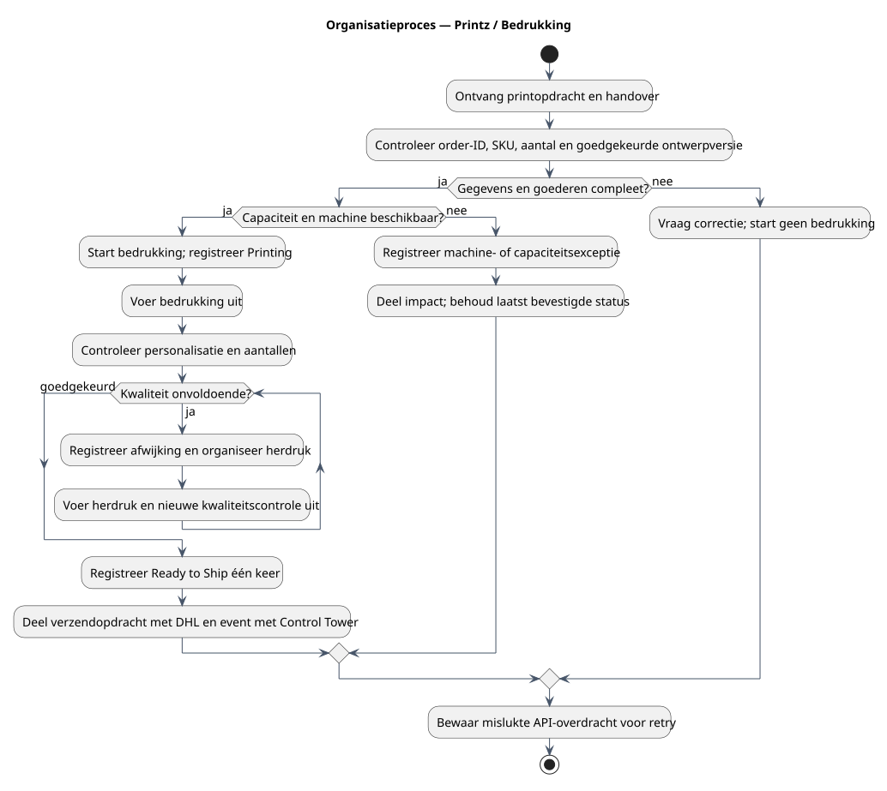

# Activitydiagram — Printz / Bedrukking

Concept voor review · #187 / #180 · FR-PRT-01 t/m 05.

[Bewerkbare UML-bron](printz.puml)

Dit diagram toont het organisatieproces van invoer tot verwerking, uitzonderingen en terugkoppeling. Het is geen Level 1/2 DFD en geen diagram van uitsluitend één use case. De start/eindknooppunten begrenzen één procescyclus; volgende orders, aankomsten of herstelacties starten een nieuwe cyclus. De weergegeven fout- en herstelroutes beschrijven gewenst gedrag, geen claim van volledige implementatie.
