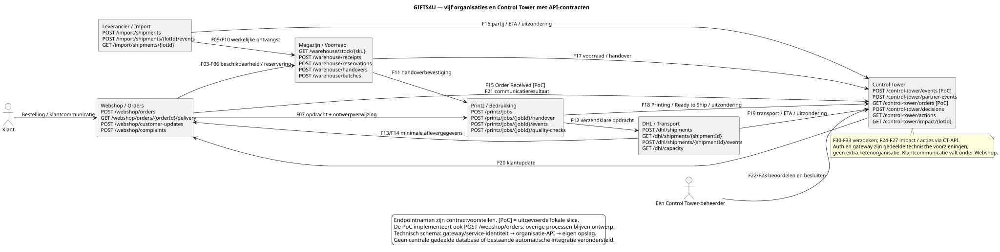

# Componentdiagram voor de hele keten

Concept voor review · #189 / #180. Zes organisatiecomponenten: vijf ketenorganisaties plus Control Tower. De namen volgen de functionele requirementgroepen. API-gateway en authenticatie zijn infrastructuur en tellen niet als organisatie; klantcommunicatie is een cross-servicefunctie, in dit voorstel onder Webshop.

[Bewerkbare UML-bron](system.puml) · [Stroomcatalogus](../api/flows.md) · [Zes OpenAPI-contracten en implementatiestatus](../api/README.md)

De bestaande componenttekening onder documents/Componentdiagram blijft referentie. Deze variant voegt de endpointgroepen en de koppeling naar DFD-stroom-ID's toe. De pijlen tonen serviceafhankelijkheden en gegevensuitwisseling; fysieke goederenstromen zijn geen API-calls.

De uitgevoerde slice is POST /webshop/orders → POST /control-tower/events → GET /control-tower/orders. De twee processen gebruiken aparte persistente opslag en communiceren via HTTP. Magazijnbeschikbaarheid is in deze slice een expliciete teststub. De overige weergegeven API's zijn ontwerpvoorstellen, niet reeds werkende integraties.

Productie moet service-identiteiten, gebruikersrechten, gatewayroutes en netwerktoegang uitwerken. In de lokale PoC beschermt een aparte servicesleutel de ontvangende eventroute; de demo luistert alleen op loopback. Er zijn geen echte partners of klantberichten verbonden.
