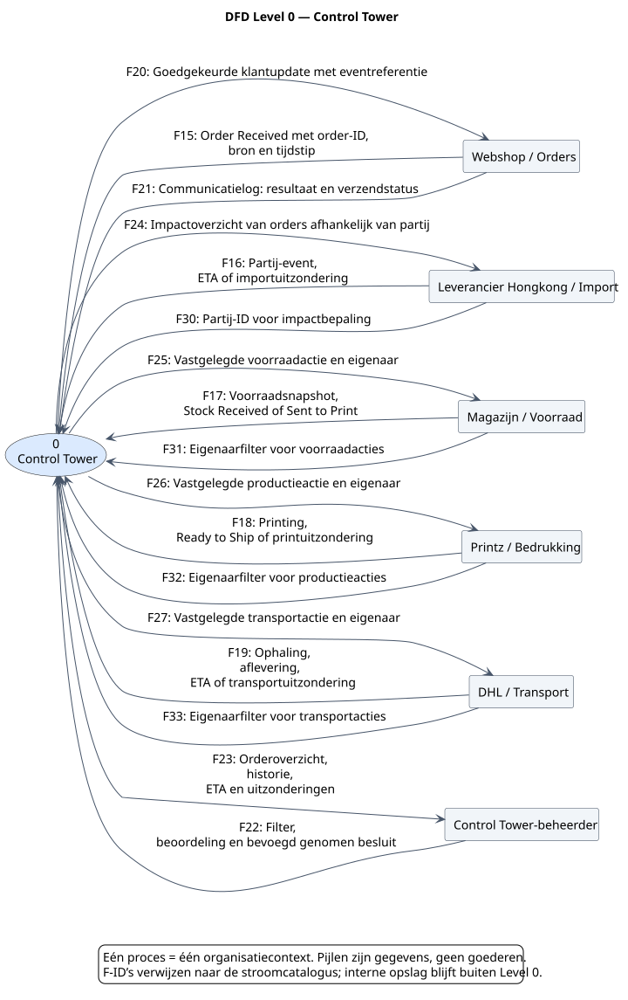

# DFD Level 0 — Control Tower

Status: concept voor teamreview. Onderdeel van #182 / #180. Requirements: FR-CT-01 t/m 11; NFR-01 t/m 08.

[Bewerkbare bron](control-tower.puml) · [Gegevensstromen en API-koppeling](../api/flows.md)

Dit diagram modelleert de hele organisatie als één proces. Externe partijen liggen buiten de grens; fysieke goederenbewegingen zijn als bevestigingsgegevens weergegeven. Er zijn geen Level 1/2-decomposities. Technische endpointkeuzes staan als ontwerpvoorstel in de stroomcatalogus.

| Stroom | Van → naar | Gegevens |
| --- | --- | --- |
| F15 | Webshop / Orders → Control Tower | Order Received met order-ID, bron en tijdstip |
| F16 | Leverancier Hongkong / Import → Control Tower | Partij-event, ETA of importuitzondering |
| F17 | Magazijn / Voorraad → Control Tower | Voorraadsnapshot, Stock Received of Sent to Print |
| F18 | Printz / Bedrukking → Control Tower | Printing, Ready to Ship of printuitzondering |
| F19 | DHL / Transport → Control Tower | Ophaling, aflevering, ETA of transportuitzondering |
| F20 | Control Tower → Webshop / Orders | Goedgekeurde klantupdate met eventreferentie |
| F21 | Webshop / Orders → Control Tower | Communicatielog: resultaat en verzendstatus |
| F22 | Control Tower-beheerder → Control Tower | Filter, beoordeling en bevoegd genomen besluit |
| F23 | Control Tower → Control Tower-beheerder | Orderoverzicht, historie, ETA en uitzonderingen |
| F24 | Control Tower → Leverancier Hongkong / Import | Impactoverzicht van orders afhankelijk van partij |
| F25 | Control Tower → Magazijn / Voorraad | Vastgelegde voorraadactie en eigenaar |
| F26 | Control Tower → Printz / Bedrukking | Vastgelegde productieactie en eigenaar |
| F27 | Control Tower → DHL / Transport | Vastgelegde transportactie en eigenaar |
| F30 | Leverancier Hongkong / Import → Control Tower | Partij-ID voor impactbepaling |
| F31 | Magazijn / Voorraad → Control Tower | Eigenaarfilter voor voorraadacties |
| F32 | Printz / Bedrukking → Control Tower | Eigenaarfilter voor productieacties |
| F33 | DHL / Transport → Control Tower | Eigenaarfilter voor transportacties |
