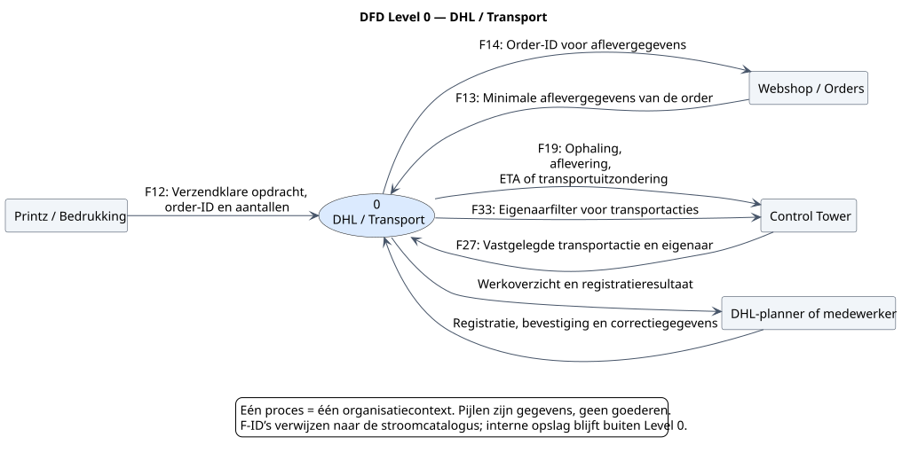

# DFD Level 0 — DHL / Transport

Status: concept voor teamreview. Onderdeel van #182 / #180. Requirements: FR-DHL-01 t/m 05.

[Bewerkbare bron](dhl.puml) · [Gegevensstromen en API-koppeling](../api/flows.md)

Dit diagram modelleert de hele organisatie als één proces. Externe partijen liggen buiten de grens; fysieke goederenbewegingen zijn als bevestigingsgegevens weergegeven. Er zijn geen Level 1/2-decomposities. Technische endpointkeuzes staan als ontwerpvoorstel in de stroomcatalogus.

| Stroom | Van → naar | Gegevens |
| --- | --- | --- |
| F12 | Printz / Bedrukking → DHL / Transport | Verzendklare opdracht, order-ID en aantallen |
| F13 | Webshop / Orders → DHL / Transport | Minimale aflevergegevens van de order |
| F14 | DHL / Transport → Webshop / Orders | Order-ID voor aflevergegevens |
| F19 | DHL / Transport → Control Tower | Ophaling, aflevering, ETA of transportuitzondering |
| F27 | Control Tower → DHL / Transport | Vastgelegde transportactie en eigenaar |
| F33 | DHL / Transport → Control Tower | Eigenaarfilter voor transportacties |
