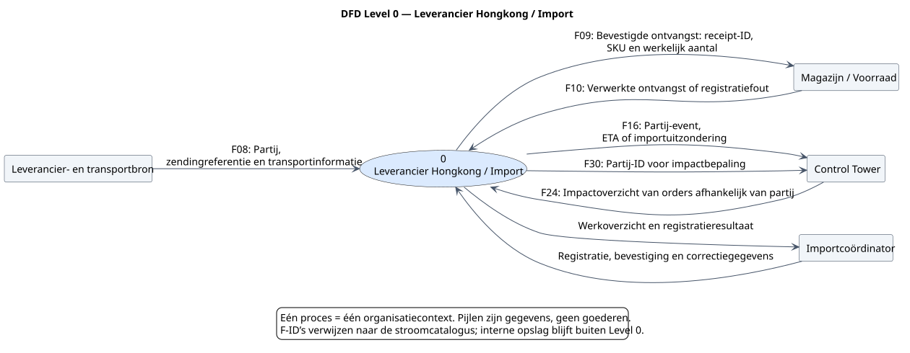

# DFD Level 0 — Leverancier Hongkong / Import

Status: concept voor teamreview. Onderdeel van #182 / #180. Requirements: FR-IMP-01 t/m 05.

[Bewerkbare bron](import.puml) · [Gegevensstromen en API-koppeling](../api/flows.md)

Dit diagram modelleert de hele organisatie als één proces. Externe partijen liggen buiten de grens; fysieke goederenbewegingen zijn als bevestigingsgegevens weergegeven. Er zijn geen Level 1/2-decomposities. Technische endpointkeuzes staan als ontwerpvoorstel in de stroomcatalogus.

| Stroom | Van → naar | Gegevens |
| --- | --- | --- |
| F08 | Leverancier- en transportbron → Leverancier Hongkong / Import | Partij, zendingreferentie en transportinformatie |
| F09 | Leverancier Hongkong / Import → Magazijn / Voorraad | Bevestigde ontvangst: receipt-ID, SKU en werkelijk aantal |
| F10 | Magazijn / Voorraad → Leverancier Hongkong / Import | Verwerkte ontvangst of registratiefout |
| F16 | Leverancier Hongkong / Import → Control Tower | Partij-event, ETA of importuitzondering |
| F24 | Control Tower → Leverancier Hongkong / Import | Impactoverzicht van orders afhankelijk van partij |
| F30 | Leverancier Hongkong / Import → Control Tower | Partij-ID voor impactbepaling |
