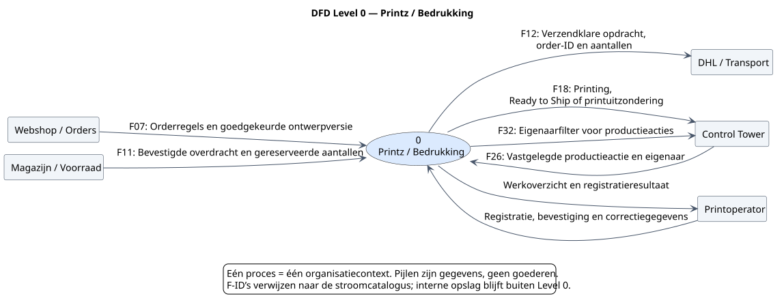

# DFD Level 0 — Printz / Bedrukking

Status: concept voor teamreview. Onderdeel van #182 / #180. Requirements: FR-PRT-01 t/m 05.

[Bewerkbare bron](printz.puml) · [Gegevensstromen en API-koppeling](../api/flows.md)

Dit diagram modelleert de hele organisatie als één proces. Externe partijen liggen buiten de grens; fysieke goederenbewegingen zijn als bevestigingsgegevens weergegeven. Er zijn geen Level 1/2-decomposities. Technische endpointkeuzes staan als ontwerpvoorstel in de stroomcatalogus.

| Stroom | Van → naar | Gegevens |
| --- | --- | --- |
| F07 | Webshop / Orders → Printz / Bedrukking | Orderregels en goedgekeurde ontwerpversie |
| F11 | Magazijn / Voorraad → Printz / Bedrukking | Bevestigde overdracht en gereserveerde aantallen |
| F12 | Printz / Bedrukking → DHL / Transport | Verzendklare opdracht, order-ID en aantallen |
| F18 | Printz / Bedrukking → Control Tower | Printing, Ready to Ship of printuitzondering |
| F26 | Control Tower → Printz / Bedrukking | Vastgelegde productieactie en eigenaar |
| F32 | Printz / Bedrukking → Control Tower | Eigenaarfilter voor productieacties |
