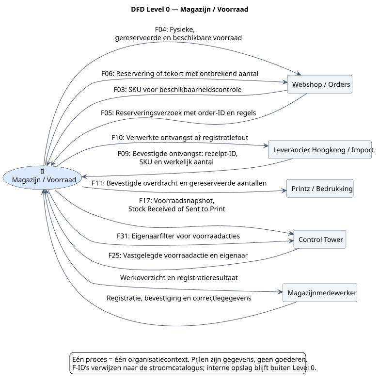

# DFD Level 0 — Magazijn / Voorraad

Status: concept voor teamreview. Onderdeel van #182 / #180. Requirements: FR-MAG-01 t/m 06.

[Bewerkbare bron](warehouse.puml) · [Gegevensstromen en API-koppeling](../api/flows.md)

Dit diagram modelleert de hele organisatie als één proces. Externe partijen liggen buiten de grens; fysieke goederenbewegingen zijn als bevestigingsgegevens weergegeven. Er zijn geen Level 1/2-decomposities. Technische endpointkeuzes staan als ontwerpvoorstel in de stroomcatalogus.

| Stroom | Van → naar | Gegevens |
| --- | --- | --- |
| F03 | Webshop / Orders → Magazijn / Voorraad | SKU voor beschikbaarheidscontrole |
| F04 | Magazijn / Voorraad → Webshop / Orders | Fysieke, gereserveerde en beschikbare voorraad |
| F05 | Webshop / Orders → Magazijn / Voorraad | Reserveringsverzoek met order-ID en regels |
| F06 | Magazijn / Voorraad → Webshop / Orders | Reservering of tekort met ontbrekend aantal |
| F09 | Leverancier Hongkong / Import → Magazijn / Voorraad | Bevestigde ontvangst: receipt-ID, SKU en werkelijk aantal |
| F10 | Magazijn / Voorraad → Leverancier Hongkong / Import | Verwerkte ontvangst of registratiefout |
| F11 | Magazijn / Voorraad → Printz / Bedrukking | Bevestigde overdracht en gereserveerde aantallen |
| F17 | Magazijn / Voorraad → Control Tower | Voorraadsnapshot, Stock Received of Sent to Print |
| F25 | Control Tower → Magazijn / Voorraad | Vastgelegde voorraadactie en eigenaar |
| F31 | Magazijn / Voorraad → Control Tower | Eigenaarfilter voor voorraadacties |
