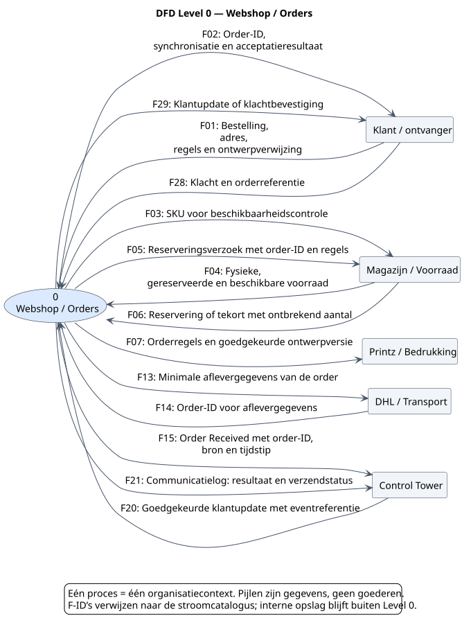

# DFD Level 0 — Webshop / Orders

Status: concept voor teamreview. Onderdeel van #182 / #180. Requirements: FR-WEB-01 t/m 06; FR-KLM-01 t/m 05.

[Bewerkbare bron](webshop.puml) · [Gegevensstromen en API-koppeling](../api/flows.md)

Dit diagram modelleert de hele organisatie als één proces. Externe partijen liggen buiten de grens; fysieke goederenbewegingen zijn als bevestigingsgegevens weergegeven. Er zijn geen Level 1/2-decomposities. Technische endpointkeuzes staan als ontwerpvoorstel in de stroomcatalogus.

| Stroom | Van → naar | Gegevens |
| --- | --- | --- |
| F01 | Klant / ontvanger → Webshop / Orders | Bestelling, adres, regels en ontwerpverwijzing |
| F02 | Webshop / Orders → Klant / ontvanger | Order-ID, synchronisatie en acceptatieresultaat |
| F03 | Webshop / Orders → Magazijn / Voorraad | SKU voor beschikbaarheidscontrole |
| F04 | Magazijn / Voorraad → Webshop / Orders | Fysieke, gereserveerde en beschikbare voorraad |
| F05 | Webshop / Orders → Magazijn / Voorraad | Reserveringsverzoek met order-ID en regels |
| F06 | Magazijn / Voorraad → Webshop / Orders | Reservering of tekort met ontbrekend aantal |
| F07 | Webshop / Orders → Printz / Bedrukking | Orderregels en goedgekeurde ontwerpversie |
| F13 | Webshop / Orders → DHL / Transport | Minimale aflevergegevens van de order |
| F14 | DHL / Transport → Webshop / Orders | Order-ID voor aflevergegevens |
| F15 | Webshop / Orders → Control Tower | Order Received met order-ID, bron en tijdstip |
| F20 | Control Tower → Webshop / Orders | Goedgekeurde klantupdate met eventreferentie |
| F21 | Webshop / Orders → Control Tower | Communicatielog: resultaat en verzendstatus |
| F28 | Klant / ontvanger → Webshop / Orders | Klacht en orderreferentie |
| F29 | Webshop / Orders → Klant / ontvanger | Klantupdate of klachtbevestiging |
