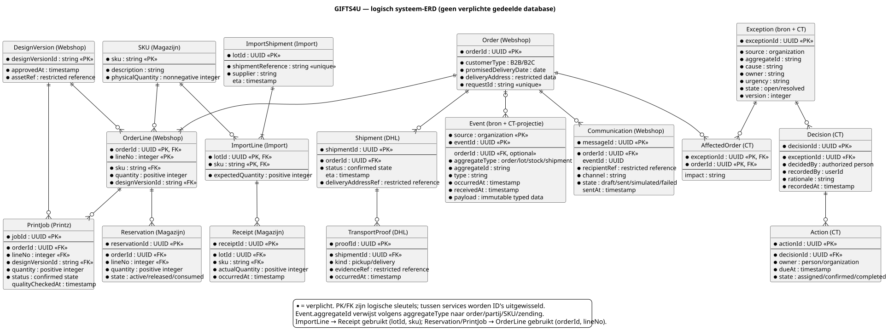

# Eén logisch systeem-ERD

Concept voor review · #188 / #180. Keuze: één logisch ketenmodel, zodat gedeelde identifiers en eigenaarschap zichtbaar zijn. Dit voldoet aan de optie ‘één ERD voor het hele logische systeem’; het schrijft geen gedeelde productiedatabase voor.

[Bewerkbare bron](system.puml) · [Bestaand ERD](../../../documents/ERD/gifts4u-erd.svg)

Het bestaande model bevat User, Order, Item, BlankProduct, ImportShipment(Line), ItemStatusHistory, Shipment, Exception, PrintJob en PrintJobStatusHistory. In deze variant worden Item en BlankProduct herkenbaar als OrderLine en SKU, en worden afzonderlijke statushistories samengebracht als het logische Event-concept. Reservering, ontvangstidentiteit, bewijs, getroffen orders en besluit/actie zijn expliciet gemaakt. Dit is een ontwerpvariant voor review; bestaande gegevens worden niet gemigreerd of verwijderd.

## Eigenaarschap en regels

- Webshop bezit order, regels, adres, ontwerpversie en klantcommunicatie. DHL ontvangt alleen aflevergegevens, geen ontwerpbestand.
- Import bezit partijen en hun verwachte aankomst; magazijn bezit fysieke voorraad, ontvangst en reserveringen. Een partij kan meerdere SKU-regels hebben, elk met nul of meer gedeeltelijke ontvangsten.
- Beschikbaar = fysiek minus actieve reserveringen; beide zijn niet-negatief. Reserveren moet transactioneel gebeuren. Een receipt-ID verhoogt voorraad maximaal eenmaal.
- Printz bezit printopdrachten en kwaliteitscontrole. Een orderregel kan worden opgesplitst in meerdere printopdrachten, bijvoorbeeld herdruk. Ontwerpversie moet overeenkomen met de goedgekeurde orderregel of een expliciet vastgelegde revisie.
- DHL bezit zending, vervoersstatus, ETA en bewijs. Eén order kan meerdere zendingen hebben. Delivered vereist geldig bewijs voor dezelfde zending; een referentie alleen bewijst de inhoud niet.
- Een Event heeft de samengestelde identiteit (source, eventId) en onveranderlijke inhoud. De bron bezit het feit, de Control Tower een ontvangen projectie. Partij-/voorraad-events hoeven geen order-ID te hebben. aggregateType/aggregateId vormen een getypeerde logische verwijzing, geen SQL-FK naar meerdere tabellen.
- Exception en status zijn onafhankelijk. AffectedOrder legt de veel-op-veel-relatie tussen uitzonderingen en orders vast. Een exception zonder bekende orderimpact kan nog geen AffectedOrder-rijen hebben.
- Een besluit kan meerdere acties hebben. decidedBy is de bevoegde beslisser; recordedBy is de ingelogde beheerder. deadline en eigenaar zijn per actie vastgelegd.
- Technische outbox, delivery attempts, credentials en authenticatietabellen zijn implementatiedetails. De bestaande User uit het eerdere ERD valt onder de auth-service; userId wordt logisch gerefereerd. Retentie en persoonsgegevensbeleid zijn nog teamkeuzes.

## Niet geïmplementeerd door dit diagram

De PoC heeft alleen orders, uitgaande events en Control Tower-projecties. De andere entiteiten zijn nog geen gerealiseerde services. Teamreview moet onder meer split shipments, gedeelde ontwerpversies, voorraadcompensatie en correcties op gebeurtenissen bevestigen.
