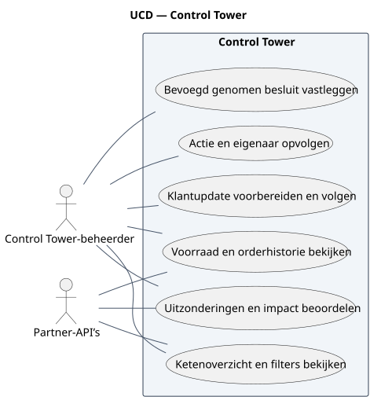

# Use-case-diagram — Control Tower

Concept voor review · #183 / #180 · FR-CT-01 t/m 11; NFR-01 t/m 08.

[Bewerkbare bron](control-tower.puml)

De Control Tower heeft één menselijke gebruiker: de beheerder. Partner-API’s leveren gegevens en zijn geen extra menselijke gebruikers. Een directeur kan buiten het systeem besluiten nemen; de beheerder legt het bevoegde besluit vast.

1. Ketenoverzicht en filters bekijken.
2. Voorraad en orderhistorie bekijken.
3. Uitzonderingen en impact beoordelen.
4. Bevoegd genomen besluit vastleggen.
5. Actie en eigenaar opvolgen.
6. Klantupdate voorbereiden en volgen.
