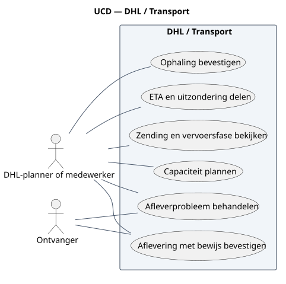

# Use-case-diagram — DHL / Transport

Concept voor review · #183 / #180 · FR-DHL-01 t/m 05.

[Bewerkbare bron](dhl.puml)

De actoren gebruiken de voorziening van deze organisatie. Dit geeft hen geen toegang tot de Control Tower. De systeemgrens omvat de volledige organisatievoorziening; de doelen zijn geen schermen of interne programmeerstappen.

1. Zending en vervoersfase bekijken.
2. Capaciteit plannen.
3. Ophaling bevestigen.
4. Aflevering met bewijs bevestigen.
5. Afleverprobleem behandelen.
6. ETA en uitzondering delen.
