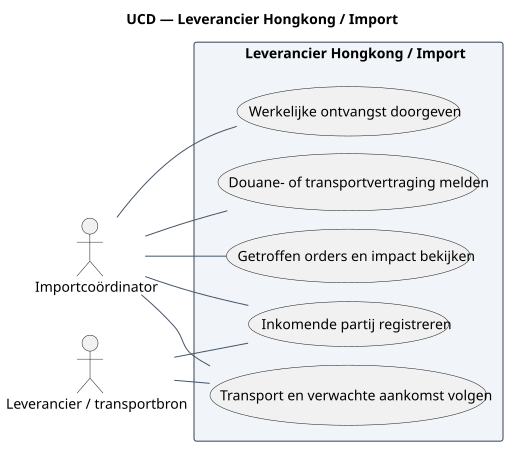

# Use-case-diagram — Leverancier Hongkong / Import

Concept voor review · #183 / #180 · FR-IMP-01 t/m 05.

[Bewerkbare bron](import.puml)

De actoren gebruiken de voorziening van deze organisatie. Dit geeft hen geen toegang tot de Control Tower. De systeemgrens omvat de volledige organisatievoorziening; de doelen zijn geen schermen of interne programmeerstappen.

1. Inkomende partij registreren.
2. Transport en verwachte aankomst volgen.
3. Douane- of transportvertraging melden.
4. Getroffen orders en impact bekijken.
5. Werkelijke ontvangst doorgeven.
