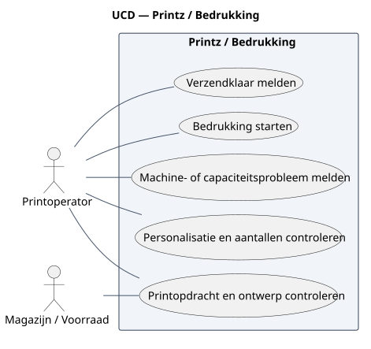

# Use-case-diagram — Printz / Bedrukking

Concept voor review · #183 / #180 · FR-PRT-01 t/m 05.

[Bewerkbare bron](printz.puml)

De actoren gebruiken de voorziening van deze organisatie. Dit geeft hen geen toegang tot de Control Tower. De systeemgrens omvat de volledige organisatievoorziening; de doelen zijn geen schermen of interne programmeerstappen.

1. Printopdracht en ontwerp controleren.
2. Bedrukking starten.
3. Machine- of capaciteitsprobleem melden.
4. Personalisatie en aantallen controleren.
5. Verzendklaar melden.
