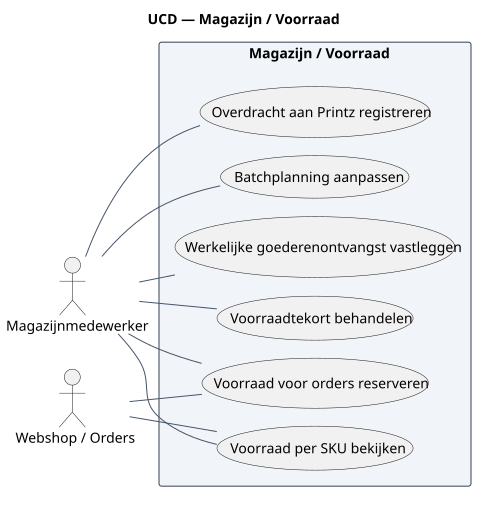

# Use-case-diagram — Magazijn / Voorraad

Concept voor review · #183 / #180 · FR-MAG-01 t/m 06.

[Bewerkbare bron](warehouse.puml)

De actoren gebruiken de voorziening van deze organisatie. Dit geeft hen geen toegang tot de Control Tower. De systeemgrens omvat de volledige organisatievoorziening; de doelen zijn geen schermen of interne programmeerstappen.

1. Werkelijke goederenontvangst vastleggen.
2. Voorraad per SKU bekijken.
3. Voorraad voor orders reserveren.
4. Voorraadtekort behandelen.
5. Overdracht aan Printz registreren.
6. Batchplanning aanpassen.
