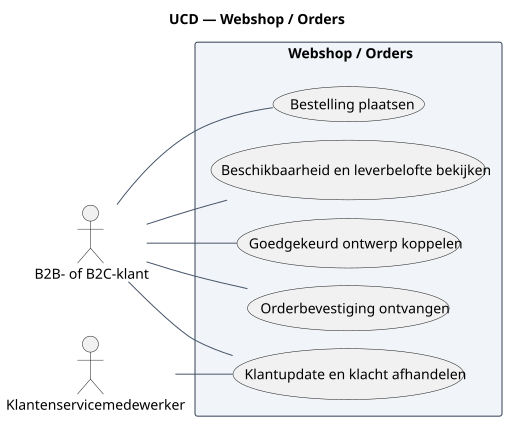

# Use-case-diagram — Webshop / Orders

Concept voor review · #183 / #180 · FR-WEB-01 t/m 06; FR-KLM-01 t/m 05.

[Bewerkbare bron](webshop.puml)

De actoren gebruiken de voorziening van deze organisatie. Dit geeft hen geen toegang tot de Control Tower. De systeemgrens omvat de volledige organisatievoorziening; de doelen zijn geen schermen of interne programmeerstappen.

1. Bestelling plaatsen.
2. Beschikbaarheid en leverbelofte bekijken.
3. Goedgekeurd ontwerp koppelen.
4. Orderbevestiging ontvangen.
5. Klantupdate en klacht afhandelen.

Klantcommunicatie en klachten zijn hier onder de Webshop geplaatst als expliciete ontwerpkeuze. Bevestig deze verantwoordelijkheid met het team; maak er niet zonder afspraak een zevende organisatie van.
