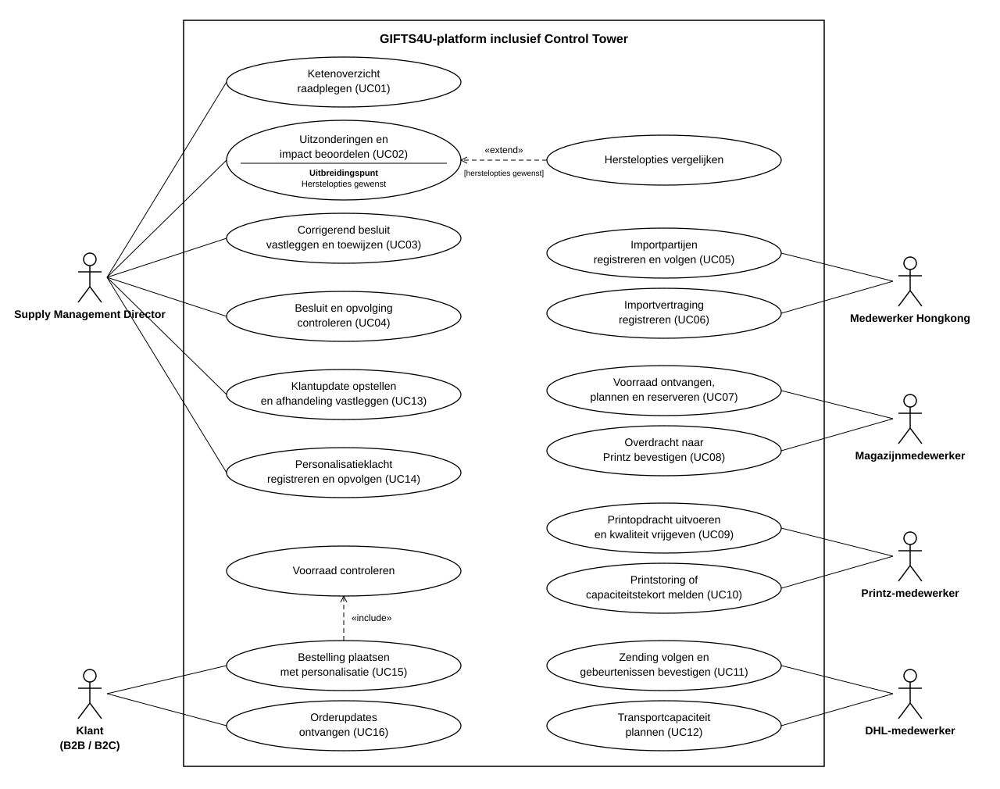

# GIFTS4U ? systeemcontext van de Control Tower

**E?n persoon houdt de Control Tower bij.** Die persoon heeft in dit ontwerp de rol **Control Tower-beheerder**. Alle acht use cases horen bij diezelfde gebruiker. Printz, DHL, het magazijn en andere ketenpartijen leveren gegevens of ontvangen opdrachten; zij zijn geen extra gebruikers van de Control Tower.

Productissue: [#73](https://github.com/Immanuel-Cairo/gifts4u-control-tower/issues/73). Pull request: [#74](https://github.com/Immanuel-Cairo/gifts4u-control-tower/pull/74). Gerelateerd aan #70 en #71.

## Diagrammen openen

- [Use-casediagram ? SVG](use-case-diagram.svg) en [PlantUML-bron](use-case-diagram.puml).
- [DFD niveau 0 ? SVG](dfd-level-0.svg) en [Mermaid-bron](dfd-level-0.mmd).




De SVG's werken lokaal zonder externe scripts of lettertypen. Donkere kop, limegroene accenten en paarse diagrammen sluiten aan op het [bestaande prototype](../prototype/index.html).

## Systeemgrens

**Binnen de grens:** uitsluitend de GIFTS4U Control Tower. Deze brengt ketengegevens samen, toont orders, voorraad, bevestigde status en verwachtingen, signaleert uitzonderingen en legt acties, besluiten en opvolging vast.

**Buiten de grens:** de beheerder als menselijke gebruiker, plus webshop/orders, importregistratie, magazijn/voorraad, Printz, DHL en klantcommunicatie als externe informatiebronnen of ontvangende diensten. Een bron kan software, een partneroverzicht of handmatig aangeleverde informatie zijn. Het diagram legt nog geen API, protocol of automatische koppeling vast.

Orders plaatsen, goederen ontvangen, voorraad reserveren, bedrukken, kwaliteitscontrole uitvoeren en pakketten afleveren gebeuren in de keten buiten de Control Tower. De beheerder **volgt de geregistreerde uitkomsten** en stuurt bij. Klanten gebruiken de webshop en ontvangen berichten via de communicatiedienst; zij bedienen de Control Tower niet.

Beide diagrammen hebben dezelfde grens. Het UCD toont de doelen van de enige menselijke gebruiker. Het DFD werkt de uitwisseling met externe bronnen uit; een externe DFD-entiteit is niet automatisch een ingelogde gebruiker. Het DFD heeft precies ??n procescirkel, nummer 0, en geen interne datastores. UCD-lijnen betekenen deelname; DFD-pijlen betekenen gegevensoverdracht, geen schermnavigatie.

## Use cases van de beheerder

UC01?UC08 zijn contextdoelen en vervangen niet de fijnmazige UC-ID's uit de requirements. De primaire actor is bij elke rij **Control Tower-beheerder**.

| ID | Doel | Resultaat | Requirementkoppeling |
| --- | --- | --- | --- |
| UC01 | Orderoverzicht raadplegen | Orders zoeken/filteren en een orderdossier bekijken met oorspronkelijke belofte, laatste bevestiging, partner en historie. | FR-CT-01, FR-CT-06, FR-CT-08 |
| UC02 | Uitzonderingen en impact beoordelen | Oorzaak, getroffen orders, urgentie en volgende actie vaststellen; status en uitzondering apart houden. Optioneel herstelopties vergelijken. | FR-CT-02, FR-CT-03, FR-CT-09, FR-CT-10; gegevens uit FR-IMP-04 |
| UC03 | Corrigerend besluit vastleggen en toewijzen | Een bevoegd genomen besluit registreren met actie, eigenaar en deadline. Een actiehouder bij een partner krijgt daarmee geen toegang tot de Control Tower. | FR-CT-04 |
| UC04 | Opvolging en logboek raadplegen | Besluiten, acties, bevestigingen en voortgang terugvinden met bron en tijdstip. | FR-CT-04, NFR-03 |
| UC05 | Voorraad en import volgen | Fysieke, gereserveerde en beschikbare voorraad bekijken; import-ETA, vertraging en orderafhankelijkheden volgen. | FR-CT-07; gegevens uit FR-MAG-01 en FR-IMP-01 t/m FR-IMP-05 |
| UC06 | Productie en transport volgen | Printstatus, kwaliteitsvrijgave, transportfase, capaciteitstekorten en geschatte levering volgen op basis van partnergegevens. | FR-CT-01, FR-CT-02, FR-CT-08; gegevens uit FR-PRT-01 t/m FR-PRT-05 en FR-DHL-01 t/m FR-DHL-05 |
| UC07 | Klantcommunicatie co?rdineren | Een update/opdracht met de juiste ordercontext vastleggen en de verzend-, klacht- en afhandelstatus volgen via de communicatiedienst. | FR-KLM-01 t/m FR-KLM-05 |
| UC08 | KPI's en meldingen bewaken | Urgente afwijkingen, dashboardmeldingen en leverlooptijd-KPI's beoordelen. | FR-CT-05, FR-CT-09, FR-CT-11 |

**E?n gebruiker betekent niet automatisch onbeperkte beslissingsbevoegdheid.** FR-CT-04 noemt de directeur als beslisser. De beheerder kan zelf de directeur/eigenaar zijn, of een buiten de applicatie genomen directiebesluit registreren. Er is in dit model geen tweede persoon die de Control Tower bedient. Wie welke besluiten mag nemen moet organisatorisch worden vastgelegd; de gebruikercorrectie bepaalt alleen wie de applicatie bijhoudt.

## Gegevenswoordenboek bij het DFD

?In? betekent naar proces 0; ?uit? betekent vanuit de Control Tower. De zeven externe entiteiten zijn ??n beheerder en zes gegevensbronnen/ontvangende diensten. Het diagram bevat elf gerichte stromen.

| ID | Richting / partij | Inhoud |
| --- | --- | --- |
| F01 | In ? beheerder | Zoek- en filtercriteria, uitzonderingsbeoordeling, acties, besluit, actiehouder en deadline. Optionele scenario-invoer blijft een voorstel. |
| F02 | Uit ? beheerder | Orderbeeld, voorraad, partnerstatus, KPI's, meldingen, impact, besluiten en opvolgingslog. |
| F03 | In ? webshop/orderservice | Uniek order-ID, klanttype, orderregels, oorspronkelijke leverbelofte en bevestigd Order Received-event met bron/tijdstip. |
| F04 | In ? importregistratie | Partijreferentie, SKU, hoeveelheid, verwachte aankomst, bevestigde importevents en vertragingen, herleidbaar tot de leverancier. |
| F05 | In ? magazijn/voorraadservice | Fysieke, gereserveerde en beschikbare aantallen; bevestigde ontvangst en overdracht naar Printz; voorraadtekorten. |
| F06 | In ? Printz | Productiestatus, bevestigde kwaliteitsvrijgave, storing, capaciteitstekort en betrokken order-ID's met bron/tijdstip. |
| F07 | Uit ? Printz | Toegewezen corrigerende actie met order/uitzondering, actiehouder en deadline. Dit is geen automatisch bewijs van uitvoering. |
| F08 | In ? DHL | Zending-ID, vervoersfase, ophaling, afleverbewijs, geschatte ETA, vraag/capaciteit en transportuitzonderingen. |
| F09 | Uit ? DHL | Toegewezen corrigerende actie met betrokken zending/order, actiehouder en deadline. |
| F10 | In ? klantcommunicatie | Verzend- en afhandelstatus, communicatielog, klacht met ordernummer en gekozen vervolgactie. |
| F11 | Uit ? klantcommunicatie | Concept/update, bevestigde status, oorzaak, belofte, ETA of expliciet onbekend, ontvanger/kanaal en communicatieopdracht. |

De stromen zijn logisch: informatie kan ook handmatig door de beheerder worden overgenomen. Bronvermelding blijft dan de partner, terwijl de invoerende actor de beheerder is. Partnerbevestigingen worden niet verzonnen door de beheerder. Een retourstroom is alleen getekend waar deze context een opdracht of update verstuurt; oorspronkelijke printopdrachten en webshopbevestigingen behoren tot de keten buiten deze grens.

## Ketenrequirements buiten de Control Tower

De [requirements](../../documents/Requirments/GIFTS4U_Requirements.md) beschrijven de hele keten. Dit contextproduct dekt de bediening van de Control Tower; het maakt niet van elke ketenhandeling een beheerderstaak.

| Requirementgroep | Plaats in de keten en relatie met de Control Tower |
| --- | --- |
| FR-WEB-01 t/m FR-WEB-06 | Orderacceptatie, adrescontrole, voorraadcontrole, B2B-prioriteit en wijzigingsbeleid horen bij de webshop. Het resultaat en Order Received komen via F03 binnen. |
| FR-IMP-01 t/m FR-IMP-05 | Partijen en importevents worden bij de importbron geregistreerd; F04 voedt UC05 en de impactbeoordeling. Bevestigde ontvangst wordt met de voorraadservice verwerkt. |
| FR-MAG-01 t/m FR-MAG-06 | Ontvangst, reserveringen, tekorten, overdracht en batchplanning horen bij de voorraadfunctie. UC05 toont de relevante uitkomsten via F05. |
| FR-PRT-01 t/m FR-PRT-05 | Opdracht, productiestart, storing en kwaliteitscontrole horen bij Printz. De beheerder volgt uitkomsten via F06 en legt zo nodig een herstelactie vast via F07. |
| FR-DHL-01 t/m FR-DHL-05 | Transportuitvoering en capaciteitsregistratie horen bij DHL. De beheerder volgt de gegevens via F08 en legt een herstelactie vast via F09. |
| FR-KLM-01 t/m FR-KLM-05 | Communicatie wordt geco?rdineerd in UC07; verzend-/afhandelgegevens en opdrachten lopen via F10/F11. Een toegewezen accountmanager is geen extra Control Tower-gebruiker. |
| FR-CT-01 t/m FR-CT-11 | Directe Control Tower-functionaliteit, gekoppeld aan UC01?UC08 hierboven. |

## Creatieve oplossing: impactverkenner voor ??n beheerder

De beheerder kan binnen UC02 optioneel een extra printshift vergelijken met reguliere herstart. Het voorstel toont getroffen orders, mogelijke tijdwinst, kostenindicatie en onzekerheden. Dit is een ontwerpuitbreiding uit de [prototypewalkthrough](../prototype/walkthrough.md), geen vastgestelde optimalisatie-eis.

1. Printz levert een storingsmelding (F06). De bevestigde orderstatus blijft bijvoorbeeld ?In bedrukking?.
2. De beheerder onderzoekt impact en scenario's (UC02). Onbekende gegevens blijven onbekend.
3. Dezelfde beheerder registreert een bevoegd besluit met eigenaar/deadline (UC03). Een opdracht kan naar Printz gaan (F07).
4. Printz bevestigt later de uitvoering (F06). Een besluit alleen verandert geen bevestigde status of oorspronkelijke leverbelofte.
5. Dezelfde beheerder co?rdineert de klantupdate (UC07, F11) en controleert de gerapporteerde afhandeling (F10).

De beheerder wisselt hiervoor niet tussen verschillende gebruikersrollen. Uitvoering bij een partner en verzending via een dienst blijven externe handelingen. De scenarioaannames uit het prototype zijn fictief.

## Bronnen en lesconventies

De correctie van de gebruiker ? ??n persoon houdt de Control Tower bij ? bepaalt de actor en afbakening van deze versie. Aanvullende inhoudelijke bronnen zijn de [requirements](../../documents/Requirments/GIFTS4U_Requirements.md) bij commit `6677d6a`, de [open opdrachtgevervragen](../../documents/Vragen/open-vragen-opdrachtgever.md), [stakeholderanalyse](../../documents/Stakeholders-analyse/stakeholderanalyse.md) en [probleemstelling](../../documents/Problemen/probleemstelling.md).

De onderstaande lesbestanden zijn lokaal in Downloads gecontroleerd en worden niet naar de repository gekopieerd.

| Referentie | Toepassing |
| --- | --- |
| `2026-Semester3-UVC-FDS-Class1-Final.pptx`, dia 34?38 | Beknopte gebruikersdoelen met actieve werkwoorden, Title Case in diagramlabels, een expliciete systeemgrens en een associatie zonder pijlpunt voor elk doel. E?n actor kan meerdere doelen hebben. |
| Hetzelfde bestand, dia 50?52 | Geen onnodige include/extend-relaties of overerving. De impactverkenner blijft een optionele variant binnen UC02. |
| `2026-Semester3-UVE-FDS-Class3-Final.pptx`, dia 9?11, 14, 17; Class 4, dia 6 | Level 0 toont het afgebakende systeem als ??n procescirkel. Externe bronnen staan buiten de grens; stroomlabels benoemen gegevensgroepen. |
| `uxd-lesson-2-flows-and-frames-v2.pdf`, pagina 9, 15, 18 | Een scenario beschrijft ervaring; een use case een gebruikersdoel; een user flow schermstappen en navigatie. Het UCD en DFD zijn geen navigatieflows. |

UML kan ook externe systemen als actor modelleren. Dit UCD toont bewust het menselijke gebruikersperspectief; gegevensuitwisseling met de omgeving staat in het bijbehorende DFD. E?n menselijke actor is een projectkeuze, geen algemene UML-regel.

## Randvoorwaarden en beperkingen

- **Beveiliging (NFR-01, NFR-06):** ??n bediener neemt authenticatie en toegangsbeperking niet weg. Een partner ontvangt alleen noodzakelijke opdrachtgegevens. Logins of rechten voor andere Control Tower-gebruikers worden hier niet toegevoegd.
- **Events (NFR-02, NFR-03):** dubbele events mogen niet dubbel wijzigen. Bewaar bron, tijdstip, betrokken record en invoerende actor.
- **Onzekerheid (NFR-04, NFR-08):** mislukte gegevensuitwisseling verandert geen bevestiging. Status, schatting en uitzondering blijven apart.
- **Kwaliteit (NFR-05, NFR-07):** laadtijd en behoud na herstart vereisen implementatie- en acceptatietests; diagrammen bewijzen deze eigenschappen niet.
- **Open beleid:** >20%-alarmgrens, kalender-/werkdagen, bevoegdheden, backorders, deellevering en automatische inkoop blijven te valideren. Geplande batchverhoging (FR-MAG-06) is geen bevestigde fysieke ontvangst (FR-MAG-02).
- **Bestaand prototype:** de eerdere demo en walkthrough bevatten nog verschillende rolweergaven en simulatieknoppen voor partnerhandelingen. Ze zijn geen bewijs van meerdere echte Control Tower-gebruikers en moeten bij een volgende prototypewijziging met deze afbakening worden afgestemd. Deze PR corrigeert het systeemcontextproduct; zij wijzigt de prototypefunctionaliteit niet.

## Onderhoud en controle

Wijzig [generate_diagrams.py](generate_diagrams.py) en genereer de SVG-, PlantUML- en Mermaid-bestanden samen:

```powershell
python "products/system context/generate_diagrams.py"
git diff --check
```

De SVG-generator heeft alleen de Python-standaardbibliotheek nodig. Een aparte PlantUML-/Mermaid-renderer kan een andere layout kiezen. Werk bij inhoudelijke wijzigingen ook de doelentabel en het gegevenswoordenboek bij.

Controle voor deze versie: ??n menselijke actor met acht geassocieerde doelen; ??n DFD-proces met zeven externe entiteiten en elf gegevensstromen; dekking van alle elf FR-CT-eisen; XML en lokale links; reproduceerbare generatie; beide SVG's lokaal gerenderd en visueel beoordeeld. Een afzonderlijke PlantUML-/Mermaid-rendering is niet uitgevoerd. Teamreview en validatie van open beleidsvragen blijven nodig voor acceptatie.
