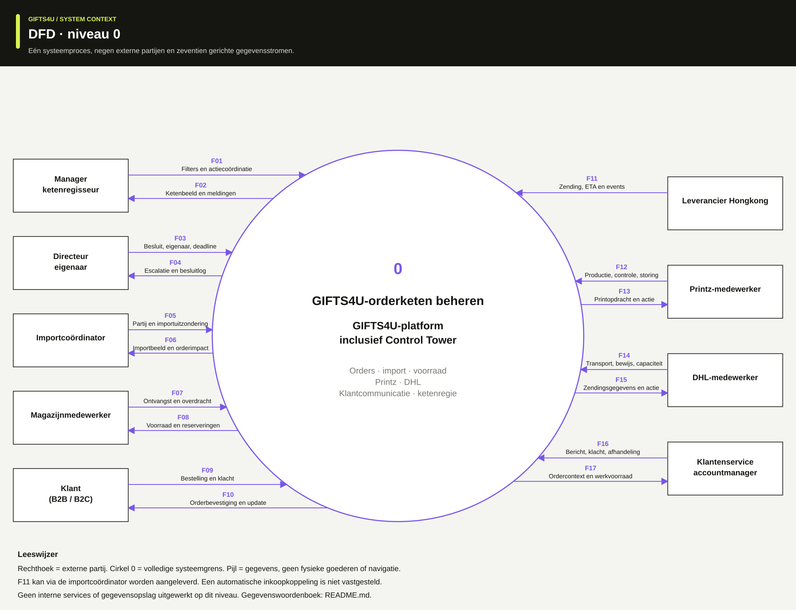

# GIFTS4U — systeemcontext van de Control Tower

**Eén persoon houdt de Control Tower bij.** Die persoon heeft in dit ontwerp de rol **Control Tower-beheerder** en is de enige menselijke actor. Daarnaast is de **tijd (klok)** een actor: niemand drukt op een knop om een order "te laat" te maken, dus de >20%-controle (FR-CT-05) start op basis van de tijd. Printz, DHL, het magazijn en andere ketenpartijen leveren gegevens of ontvangen opdrachten; zij zijn geen gebruikers van de Control Tower.

Productissue: [#73](https://github.com/Immanuel-Cairo/gifts4u-control-tower/issues/73). Pull request: [#74](https://github.com/Immanuel-Cairo/gifts4u-control-tower/pull/74). Gerelateerd aan #70 en #71.

## Diagrammen openen

- [Use-casediagram — SVG](use-case-diagram.svg) en bewerkbare [draw.io-bron](use-case-diagram.drawio).
- [DFD niveau 0 — SVG](dfd-level-0.svg) en [Mermaid-bron](dfd-level-0.mmd).




Het use-casediagram volgt dezelfde notatie als het VeloVault-UCD uit de car-auction-opdracht van Team 11: zwart-wit UML, systeemgrens als rechthoek, menselijke actor links, tijdactor rechts, associaties zonder pijlpunt en `«include»`/`«extend»` alleen waar gedrag gedeeld of optioneel is. De SVG's werken lokaal zonder externe scripts of lettertypen.

## Systeemgrens

**Binnen de grens:** uitsluitend de GIFTS4U Control Tower. Deze brengt ketengegevens samen, toont orders, voorraad, bevestigde status en verwachtingen, signaleert uitzonderingen en legt acties, besluiten en opvolging vast.

**Buiten de grens:** de beheerder als menselijke gebruiker, de tijd als triggerbron, plus webshop/orders, importregistratie, magazijn/voorraad, Printz, DHL en klantcommunicatie als externe informatiebronnen of ontvangende diensten. Een bron kan software, een partneroverzicht of handmatig aangeleverde informatie zijn. Het diagram legt nog geen API, protocol of automatische koppeling vast.

Orders plaatsen, goederen ontvangen, voorraad reserveren, bedrukken, kwaliteitscontrole uitvoeren en pakketten afleveren gebeuren in de keten buiten de Control Tower. De beheerder **volgt de geregistreerde uitkomsten** en stuurt bij. Klanten gebruiken de webshop en ontvangen berichten via de communicatiedienst; zij bedienen de Control Tower niet.

Beide diagrammen hebben dezelfde grens. Het UCD toont de doelen van de actoren. Het DFD werkt de uitwisseling met externe bronnen uit; een externe DFD-entiteit is niet automatisch een ingelogde gebruiker. Het DFD heeft precies één procescirkel, nummer 0, en geen interne datastores. UCD-lijnen betekenen deelname; DFD-pijlen betekenen gegevensoverdracht, geen schermnavigatie.

## Use cases

UC01–UC11 zijn contextdoelen en vervangen niet de fijnmazige UC-ID's uit de requirements.

| ID | Actor | Doel | Resultaat | Requirementkoppeling |
| --- | --- | --- | --- | --- |
| UC01 | Beheerder | Orderoverzicht Raadplegen | Orders zoeken/filteren en een orderdossier bekijken met oorspronkelijke belofte, laatste bevestiging, partner, uitvoerbare acties en historie. | FR-CT-01, FR-CT-06, FR-CT-08, FR-DHL-01 |
| UC02 | Beheerder | Uitzondering En Impact Beoordelen | Oorzaak, urgentie en volgende actie vaststellen; status en uitzondering apart houden. Bevat altijd *Getroffen Orders Bepalen*. | FR-CT-02, FR-CT-03, FR-CT-09, FR-CT-10; gegevens uit FR-IMP-04 |
| UC03 | Beheerder | Corrigerend Besluit Vastleggen | Een bevoegd genomen besluit registreren met actie, eigenaar en deadline. Een actiehouder bij een partner krijgt daarmee geen toegang tot de Control Tower. | FR-CT-04 |
| UC04 | Beheerder | Opvolging En Logboek Raadplegen | Besluiten, acties, bevestigingen en voortgang terugvinden met bron en tijdstip. | FR-CT-04, NFR-03 |
| UC05 | Beheerder | Voorraad En Import Volgen | Fysieke, gereserveerde en beschikbare voorraad per SKU bekijken (voorraadtabblad); import-ETA, vertraging en orderafhankelijkheden volgen. | FR-CT-07; gegevens uit FR-MAG-01 en FR-IMP-01 t/m FR-IMP-05 |
| UC06 | Beheerder | Productie En Transport Volgen | Printstatus, kwaliteitsvrijgave, positie in de DHL-route, capaciteitstekorten en geschatte levering volgen op basis van partnergegevens. | FR-CT-01, FR-CT-08; gegevens uit FR-PRT-01 t/m FR-PRT-05 en FR-DHL-01 t/m FR-DHL-05 |
| UC07 | Beheerder | Klantcommunicatie Coördineren | Een update/opdracht met de juiste ordercontext vastleggen en de verzend-, klacht- en afhandelstatus volgen via de communicatiedienst. | FR-KLM-01 t/m FR-KLM-05 |
| UC08 | Beheerder | Meldingen En KPI's Bewaken | Urgente afwijkingen bovenaan zien, dashboardmeldingen (er gaan geen e-mails uit) en leverlooptijd-KPI's beoordelen. | FR-CT-05, FR-CT-09, FR-CT-11 |
| UC09 | Beheerder | Ketenverstoring Simuleren (Demo) | Op de demodag een partnergebeurtenis nabootsen, bijv. printstart, printerstoring of importvertraging (douane, brand in Hongkong). Het event is als **Demo** gemarkeerd en bevat altijd *Getroffen Orders Bepalen*. | FR-IMP-03, FR-PRT-02, FR-PRT-03 |
| UC10 | Tijd (klok) | Leverlooptijd Bewaken | De klok start periodiek de vergelijking van verstreken looptijd met de oorspronkelijke belofte (normaal 5 dagen voor B2B en B2C). | FR-CT-05 |
| UC11 | Beheerder | Batchaantal Hongkong Verhogen | Voor piekperiodes (Kerst, Valentijn) handmatig het bestelaantal richting Hongkong verhogen; zichtbaar in het voorraadoverzicht en het log. Alleen aantallen producten, geen bedragen. | FR-MAG-06 |
| — | (via UC02, UC09) | Getroffen Orders Bepalen | Orders koppelen die afhankelijk zijn van de getroffen partij, SKU, printopdracht of zending; onbekend blijft onbekend. | FR-CT-03, FR-IMP-03, FR-IMP-04, FR-PRT-03 |
| — | (via UC02) | Herstelscenario Vergelijken | Impactverkenner: bijv. extra printshift tegenover reguliere herstart, met getroffen orders, tijdwinst en onzekerheden (geen kosten: geld is buiten scope). | Ontwerpuitbreiding (prototype), geen vastgestelde eis |
| — | (via UC10) | Vertragingsalarm Tonen | Dashboardmelding met order, oorzaak en tijdstip bij looptijd > 120% van de belofte. | FR-CT-05, FR-CT-11 |

### Relatiekeuzes

- **UC02 `«include»` Getroffen Orders Bepalen** en **UC09 `«include»` Getroffen Orders Bepalen:** elke impactbeoordeling en elke (gesimuleerde) storing koppelt altijd de getroffen orders (FR-CT-03, FR-IMP-03, FR-PRT-03). Het gedrag is verplicht en wordt door twee use cases gedeeld; de pijl wijst van het basisgeval naar het opgenomen geval.
- **Herstelscenario Vergelijken `«extend»` UC02:** alleen als de beheerder een herstelscenario wil vergelijken, op extension point `herstelscenario gewenst`. Optioneel gedrag; de pijl wijst van de uitbreiding naar het basisgeval.
- **Vertragingsalarm Tonen `«extend»` UC10:** het alarm volgt alleen wanneer de looptijd meer dan 120% van de belofte is, op extension point `looptijd > 120% van belofte`. Precies 20% geeft geen alarm (acceptatiecriterium FR-CT-05). Kalender- of werkdagen is nog een open vraag (6.1).
- **Tijd (klok)** is een tijdactor, net als *Calendar* in VeloVault: het enige wat deze actor doet is UC10 starten. Het alarm bereikt de beheerder via het dashboard (UC08), niet via e-mail.
- **Geen relatie tussen UC03 en eigenaar/deadline toewijzen:** dat is een stap binnen UC03, geen afzonderlijk doel. Zo blijven er geen onnodige include/extend-relaties (FDS Class 1, dia 50–52).

## Gegevenswoordenboek bij het DFD

"In" betekent naar proces 0; "uit" betekent vanuit de Control Tower. De acht externe entiteiten zijn één beheerder, zes gegevensbronnen/ontvangende diensten en de tijd. Het diagram bevat dertien gerichte stromen.

| ID | Richting / partij | Inhoud |
| --- | --- | --- |
| F01 | In — beheerder | Zoek- en filtercriteria, uitzonderingsbeoordeling, acties, besluit, actiehouder en deadline. Optionele scenario-invoer blijft een voorstel. In de demo ook gesimuleerde partnerevents (UC09), gemarkeerd als **Demo**. |
| F02 | Uit — beheerder | Orderbeeld, voorraad, partnerstatus, KPI's, dashboardmeldingen en vertragingsalarmen, impact, besluiten en opvolgingslog. |
| F03 | In — webshop/orderservice | Uniek order-ID (ongewijzigd in de hele keten), klanttype, één of meer orderregels, oorspronkelijke leverbelofte en bevestigd Order Received-event met bron/tijdstip. |
| F04 | In — leverancier Hongkong / import | Partijreferentie, SKU, hoeveelheid, verwachte aankomst (1 dag verwerking + ca. 10 werkdagen transport) en de status 'Delayed' bij vertraging (douane, brand of andere oorzaak). Hongkong levert geen voorraadstand en geen verdere details. |
| F05 | In — magazijn/voorraadservice | Fysieke, gereserveerde en beschikbare aantallen; bevestigde ontvangst en overdracht naar Printz; voorraadtekorten; handmatig verhoogde batchaantallen. |
| F06 | In — Printz | De vier statussen die de Control Tower moet kennen: opdracht ontvangen, in productie, gereed (na kwaliteitsvrijgave), verzonden; plus storing/capaciteitstekort met betrokken order-ID's, bron en tijdstip. Geen lijst van alle printopdrachten. |
| F07 | Uit — Printz | Toegewezen corrigerende actie met order/uitzondering, actiehouder en deadline. Dit is geen automatisch bewijs van uitvoering. |
| F08 | In — DHL | Zending-ID, positie in de DHL-route (vervoersfase), ophaling, afleverbewijs, geschatte ETA, vraag/capaciteit en transportuitzonderingen. |
| F09 | Uit — DHL | Toegewezen corrigerende actie met betrokken zending/order, actiehouder en deadline. |
| F10 | In — klantcommunicatie | Verzend- en afhandelstatus, communicatielog, klacht met ordernummer en gekozen vervolgactie. |
| F11 | Uit — klantcommunicatie | Concept/update, bevestigde status, oorzaak, belofte, ETA of expliciet onbekend, ontvanger/kanaal en communicatieopdracht. |
| F12 | In — tijd/klok | Huidige datum en tijd als controlemoment voor de leverlooptijd (UC10). |
| F13 | Uit — leverancier Hongkong / import | Verhoogd batchaantal per SKU voor een piekperiode (UC11), in aantallen producten. |

De stromen zijn logisch: informatie kan ook handmatig door de beheerder worden overgenomen. Bronvermelding blijft dan de partner, terwijl de invoerende actor de beheerder is. Partnerbevestigingen worden niet verzonnen door de beheerder; gesimuleerde events (F01) zijn altijd als demo herkenbaar. Een retourstroom is alleen getekend waar deze context een opdracht of update verstuurt; oorspronkelijke printopdrachten en webshopbevestigingen behoren tot de keten buiten deze grens. Er is geen e-maildienst: meldingen gaan via het dashboard (FR-CT-11).

## Wat de Q&A met de klant veranderde (main, 6677d6a)

| Wijziging in de requirements | Gevolg voor de contextdiagrammen |
| --- | --- |
| FR-PRT-02/03 en FR-IMP-03: storingen en vertragingen moeten in de demo **gesimuleerd** kunnen worden (bijv. via een knop) | Nieuwe UC09 Ketenverstoring Simuleren (Demo); F01 bevat demo-events. |
| FR-CT-05 (>20%-regel) en FR-CT-11 (dashboardmeldingen zonder e-mail) | Tijdactor met UC10 en `«extend»` Vertragingsalarm Tonen; F12 in het DFD; geen e-mailentiteit. |
| FR-CT-06 t/m FR-CT-10: filteren, voorraadtabblad, orderdetail, actie-items bovenaan, oorzaaksamenvatting | Gedekt door UC01, UC02, UC05 en UC08. |
| FR-WEB-01: één of meer orderregels; ordernummer ongewijzigd door de keten | F03 aangevuld. |
| FR-DHL-01: per order de positie in de DHL-route | UC06 en F08 aangevuld. |
| FR-WEB-06 (geen wijziging/annulering na plaatsing) | Webshopfunctie buiten de grens; resultaat komt via F03 binnen. |
| FR-MAG-06 (batch handmatig verhogen) | UC11 Batchaantal Hongkong Verhogen met uitgaande stroom F13 (zie klantfeedback hieronder). |
| FR-KLM-05 naar COULD HAVE | Blijft binnen UC07; geen diagramwijziging. |

## Klantfeedback uit de presentaties

Bron: aantekeningen bij de presentaties van de eigen groep, team Jarno/Renzo/Nathan/Lyam/Luuk, het eigen team en team Aron/Tijmen/Twan. Alleen punten die de systeemcontext raken staan hier; UI-wensen (kleuren, volgorde op het scherm) horen bij het prototype.

| Feedback | Verwerking in UCD/DFD |
| --- | --- |
| Webshop staat los van de Control Tower; orders worden niet in de Control Tower gemaakt | Webshop is een externe entiteit (F03); er is geen use case "order aanmaken". |
| Probleem melden bij fout in kwaliteit, aantal of tijd; de Control Tower meldt niet zelf aan de klant | Uitzonderingen via F04–F08 en UC02; tijd via UC10. Klantberichten lopen via de klantcommunicatiedienst (UC07, F11); klanten bedienen de Control Tower niet. |
| Normale levertijd 5 dagen (B2B en B2C); Hongkong 1 dag verwerking + 2 weken (10 werkdagen) | Basis voor UC10 en het alarm (>120%, dus meer dan 6 dagen); F04 bevat de ETA. |
| Printz: ontvangen, in productie, gereed, verzonden. Geen lijst van printopdrachten | F06 toont precies deze vier statussen plus storing. |
| Hongkong geeft alleen "Delayed"; geen voorraad in Hongkong, wel vertraging (bijv. brand) mogelijk | F04 aangepast; vertraging is in de demo te simuleren (UC09). |
| Happy flow plus een knop om een probleem na te bootsen, bij Printz en Hongkong | UC09 Ketenverstoring Simuleren (Demo). |
| Op een order klikken voor status, acties, uitzonderingen en historie; filters; groot voorraadtabblad | UC01 en UC05. |
| Eerst zien waar actie op nodig is (management boven voorraad); oorzaak abstract samengevat op de homepagina | UC08 en UC02. |
| Batches handmatig verhogen voor Kerst/Valentijn, richting Hongkong | Nieuwe UC11 met uitgaande stroom F13. |
| DHL: laat zien waar in de route de zending is, geen groot zendingenoverzicht | UC06 en F08 (positie in de DHL-route). |
| Geen annuleringen of adreswijzigingen; één order kan meerdere SKU's hebben; origineel ordernummer door de hele keten | F03; FR-WEB-06 blijft bij de webshop. |
| Geld en marge buiten scope, alleen aantallen producten | Kostenindicatie verwijderd uit Herstelscenario Vergelijken; F13 en voorraadstromen in aantallen. |
| Magazijn is één voorraad, niet apart voor B2B en B2C | F05 ongewijzigd; toelichting bij FR-MAG. |
| Dashboardmeldingen omdat er geen e-mailnotificaties zijn | Vertragingsalarm en meldingen via F02/UC08; geen e-maildienst in het DFD. |
| Douane: alleen "zit vast"; DHL weet dat en wacht af of geeft door (keuze van het team) | Nog open, zie randvoorwaarden. Voorlopig komt de vertraging binnen via F04. |
| Retour bij beschadiging is een could have; focus op de main flow | FR-KLM-05 blijft COULD HAVE binnen UC07; geen aparte use case. |
| Afmetingen/gewicht voor DHL, same-day shipping voor bedrijven, KvK-nummer (could have), 10 s tussen reserveren en order | Uitvoering bij DHL/webshop/magazijn buiten de grens; geen Control Tower-doel. |

## Ketenrequirements buiten de Control Tower

De [requirements](../../documents/Requirments/GIFTS4U_Requirements.md) beschrijven de hele keten. Dit contextproduct dekt de bediening van de Control Tower; het maakt niet van elke ketenhandeling een beheerderstaak.

| Requirementgroep | Plaats in de keten en relatie met de Control Tower |
| --- | --- |
| FR-WEB-01 t/m FR-WEB-06 | Orderacceptatie, adrescontrole, voorraadcontrole, B2B-prioriteit en wijzigingsbeleid horen bij de webshop. Het resultaat en Order Received komen via F03 binnen. |
| FR-IMP-01 t/m FR-IMP-05 | Partijen en importevents worden bij de importbron geregistreerd; F04 voedt UC05 en de impactbeoordeling. In de demo kan een vertraging via UC09 worden gesimuleerd. |
| FR-MAG-01 t/m FR-MAG-06 | Ontvangst, reserveringen, tekorten en overdracht horen bij de voorraadfunctie (één gezamenlijke voorraad, niet gesplitst naar B2B/B2C). UC05 toont de uitkomsten via F05. Het verhogen van het batchaantal richting Hongkong doet de beheerder in UC11 (F13). |
| FR-PRT-01 t/m FR-PRT-05 | Opdracht, productiestart, storing en kwaliteitscontrole horen bij Printz. De beheerder volgt uitkomsten via F06, simuleert ze in de demo via UC09 en legt zo nodig een herstelactie vast via F07. |
| FR-DHL-01 t/m FR-DHL-05 | Transportuitvoering en capaciteitsregistratie horen bij DHL. De beheerder volgt de gegevens via F08 en legt een herstelactie vast via F09. |
| FR-KLM-01 t/m FR-KLM-05 | Communicatie wordt gecoördineerd in UC07; verzend-/afhandelgegevens en opdrachten lopen via F10/F11. Een toegewezen accountmanager is geen extra Control Tower-gebruiker. |
| FR-CT-01 t/m FR-CT-11 | Directe Control Tower-functionaliteit, gekoppeld aan UC01–UC10 hierboven. |

## Creatieve oplossing: impactverkenner voor één beheerder

De beheerder kan binnen UC02 optioneel een extra printshift vergelijken met reguliere herstart (`«extend»` Herstelscenario Vergelijken). Het voorstel toont getroffen orders, mogelijke tijdwinst en onzekerheden. Kosten worden niet getoond: volgens de klantfeedback is geld buiten scope. Dit is een ontwerpuitbreiding uit de [prototypewalkthrough](../prototype/walkthrough.md), geen vastgestelde optimalisatie-eis.

1. Printz levert een storingsmelding (F06), of de beheerder simuleert die op de demodag (UC09, F01). De bevestigde orderstatus blijft bijvoorbeeld "In bedrukking".
2. De beheerder onderzoekt impact en scenario's (UC02). Onbekende gegevens blijven onbekend.
3. Dezelfde beheerder registreert een bevoegd besluit met eigenaar/deadline (UC03). Een opdracht kan naar Printz gaan (F07).
4. Printz bevestigt later de uitvoering (F06). Een besluit alleen verandert geen bevestigde status of oorspronkelijke leverbelofte.
5. Dezelfde beheerder coördineert de klantupdate (UC07, F11) en controleert de gerapporteerde afhandeling (F10).

## Bronnen en lesconventies

De correctie van de gebruiker — één persoon houdt de Control Tower bij — bepaalt de menselijke actor. Notatie en relatiegebruik zijn afgestemd op het VeloVault-UCD (car-auction-assignment_team11, `products/system-context`). Inhoudelijke bronnen zijn de [requirements](../../documents/Requirments/GIFTS4U_Requirements.md) bij commit `6677d6a`, de [open opdrachtgevervragen](../../documents/Vragen/open-vragen-opdrachtgever.md), [stakeholderanalyse](../../documents/Stakeholders-analyse/stakeholderanalyse.md) en [probleemstelling](../../documents/Problemen/probleemstelling.md).

| Referentie | Toepassing |
| --- | --- |
| `2026-Semester3-UVC-FDS-Class1-Final.pptx`, dia 34–38 | Beknopte gebruikersdoelen met actieve werkwoorden, Title Case in diagramlabels, een expliciete systeemgrens en een associatie zonder pijlpunt voor elk doel. |
| Hetzelfde bestand, dia 50–52 | `«include»` alleen voor verplicht, gedeeld gedrag; `«extend»` alleen voor optioneel gedrag met extension point en conditie. Geen overerving. |
| `2026-Semester3-UVE-FDS-Class3-Final.pptx`, dia 9–11, 14, 17; Class 4, dia 6 | Level 0 toont het afgebakende systeem als één procescirkel. Externe bronnen staan buiten de grens; stroomlabels benoemen gegevensgroepen. |
| `uxd-lesson-2-flows-and-frames-v2.pdf`, pagina 9, 15, 18 | Een scenario beschrijft ervaring; een use case een gebruikersdoel; een user flow schermstappen en navigatie. Het UCD en DFD zijn geen navigatieflows. |

UML kan ook externe systemen als actor modelleren. Dit UCD toont bewust alleen de menselijke gebruiker en de tijd; gegevensuitwisseling met de ketenpartners staat in het DFD.

## Randvoorwaarden en beperkingen

- **Beveiliging (NFR-01, NFR-06):** één bediener neemt authenticatie en toegangsbeperking niet weg. Een partner ontvangt alleen noodzakelijke opdrachtgegevens.
- **Events (NFR-02, NFR-03):** dubbele events mogen niet dubbel wijzigen. Bewaar bron, tijdstip, betrokken record en invoerende actor; demo-events blijven als simulatie herkenbaar.
- **Onzekerheid (NFR-04, NFR-08):** mislukte gegevensuitwisseling verandert geen bevestiging. Status, schatting en uitzondering blijven apart.
- **Kwaliteit (NFR-05, NFR-07):** laadtijd en behoud na herstart vereisen implementatie- en acceptatietests; diagrammen bewijzen deze eigenschappen niet.
- **Open beleid:** kalender-/werkdagen bij de 120%-regel (vraag 6.1; de klant noemde Hongkong in werkdagen, de 5 dagen levertijd niet expliciet), wat de "special request" bij Hongkong precies inhoudt, of de douanestatus via Hongkong of via DHL binnenkomt (team moet kiezen), "extra hoge prioriteit" (5.1), backorders en deellevering (2.3, 2.4) en automatische inkoop (2.2) blijven te valideren. Geplande batchverhoging (FR-MAG-06) is geen bevestigde fysieke ontvangst (FR-MAG-02).
- **Prototype:** de Partnerdemo in het [prototype](../prototype/walkthrough.md) is de uitwerking van UC09; het zijn simulaties door dezelfde beheerder, geen extra gebruikersrollen.

## Onderhoud en controle

Wijzig [generate_diagrams.py](generate_diagrams.py) en genereer de SVG-, draw.io- en Mermaid-bestanden samen:

```powershell
python "products/system context/generate_diagrams.py"
git diff --check
```

De generator heeft alleen de Python-standaardbibliotheek nodig. Wie liever in draw.io werkt, kan `use-case-diagram.drawio` openen en de SVG daar exporteren; neem de wijziging dan ook over in de generator, anders overschrijft de volgende generatie haar. Werk bij inhoudelijke wijzigingen ook de use-casetabel en het gegevenswoordenboek bij.

Controle voor deze versie: twee actoren (beheerder, tijd) met elf geassocieerde doelen, twee `«include»`- en twee `«extend»`-relaties; één DFD-proces met acht externe entiteiten en dertien gegevensstromen; dekking van alle elf FR-CT-eisen; XML-validatie van de SVG's en de draw.io-bron; beide SVG's lokaal gerenderd en visueel beoordeeld. Openen van de draw.io-bron in draw.io zelf is niet uitgevoerd. Teamreview en validatie van open beleidsvragen blijven nodig voor acceptatie.
